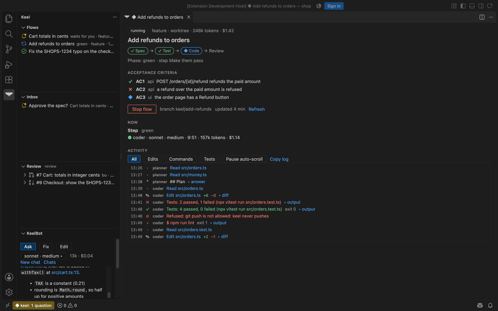
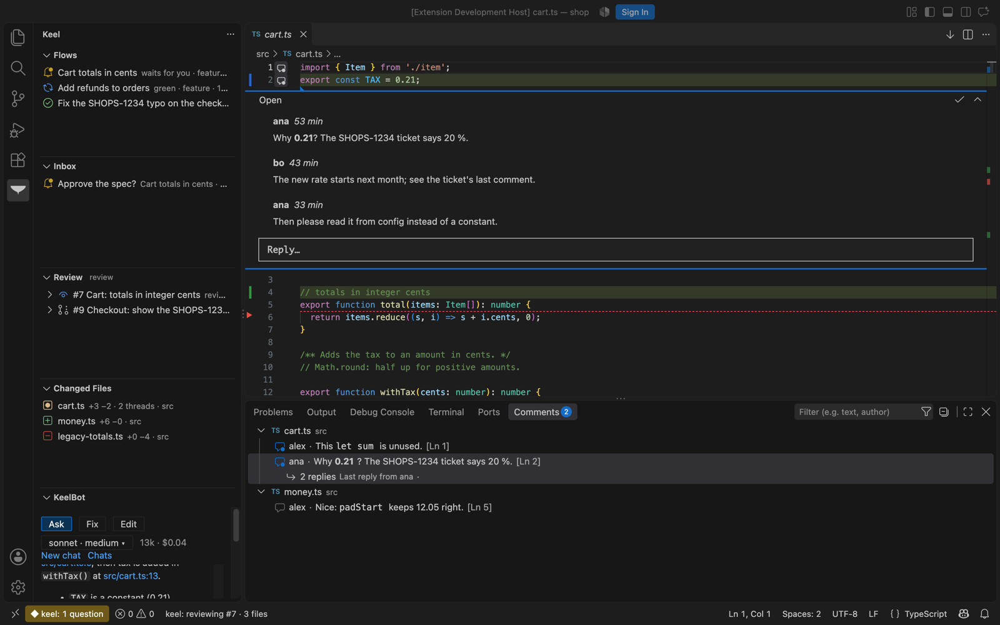

# keel in VS Code

The keel extension ([vscode/](../vscode/README.md), VS Code 1.90 and newer) brings keel into the editor, with the same
features as the [JetBrains plugin](../jetbrains/README.md): the flows of your project and what their agents do right
now, the questions they wait at, pull request review in the normal editors, and KeelBot.

<p align="center">
  
</p>

```
  keel (the api, :8088)                          VS Code
  ┌───────────────────────────────┐            ┌──────────────────────────────────────────┐
  │ /api/projects, …/runs, /inbox │──  GET  ──▶│ sidebar: Flows, Inbox, Review, KeelBot   │
  │ …/flows/{tid}, /api/jobs      │            │ flow tab: steps, criteria, gate, Stop    │
  │ …/review/view, …/diff         │            │ review mode: editor marks + comments     │
  │ /api/events (SSE)             │── stream ─▶│ live activity, status bar, notifications │
  │ /api/inbox/{tid}/act, …/stop  │◀── POST ───│ your answers (only when you click)       │
  └───────────────────────────────┘            └──────────────────────────────────────────┘
```

## Install

```sh
cd vscode && npm ci && npm run package
code --install-extension keel-vscode-0.1.0.vsix
```

## Connect

**keel: Connect** asks for keel's address (the setting `keel.url`, `http://localhost:8088` by default) and how to sign in:

- **Use keel2 on this computer**: runs `keel2 auth key` and keeps the key in memory. With keel on this computer and no
  stored key, the extension does this on its own (`keel.useLocalKeel2`).
- **Paste an API key**: the key from `keel2 auth key`, kept in VS Code's secret storage (the OS keychain), never in
  settings files.
- **Pair with a code**: keel › Settings › Devices › Pair shows a one-time code; the extension calls
  `POST /api/devices/pair {code, name: "VS Code on <host>", platform: "vscode"}` and keeps the device token in the
  secret storage. Removing the device in keel signs VS Code out.

Every call sends `Authorization: Bearer <key or token>` and `X-Keel-Via: vscode`. The keel project is found by
matching the workspace folder to keel's project paths (keel usually runs in Docker, so `/projects/shop` and
`/Users/ana/code/shop` match by folder name); **keel: Pick project** chooses it by hand.

## What is where

| Where                                                          | What                                                                                                                                                                                                                                                                                                                              | keel api                                                                                                                                |
| -------------------------------------------------------------- | --------------------------------------------------------------------------------------------------------------------------------------------------------------------------------------------------------------------------------------------------------------------------------------------------------------------------------- | --------------------------------------------------------------------------------------------------------------------------------------- |
| Sidebar › Flows                                                | the project's flows, waiting and running ones on top                                                                                                                                                                                                                                                                              | `GET …/runs`                                                                                                                            |
| Flow tab                                                       | step bar, phase, criteria red / green, the gate with exactly the offered choices (a reason box when one needs it), Stop flow, Resume                                                                                                                                                                                              | `GET …/flows/{tid}`, `POST /api/inbox/{tid}/act` (409: it asks something else now), `/api/threads/{tid}/stop`, `…/history` + `…/rewind` |
| Flow tab › Now, Activity                                       | running agents (model, elapsed, tokens, cost); reads, edits with +/− (click opens the file), commands with exit code and folded output, tests, guard refusals, gates; agents' answers as markdown, folded; All / Edits / Commands / Tests; auto-scroll with Pause; Copy log                                                       | `GET /api/events` (SSE), `GET /api/jobs?project=` + `/api/jobs/{call}/steps` for a flow opened mid-run                                  |
| Sidebar › Inbox, status bar, notifications                     | the questions waiting; `◆ keel: 1 question` or the running flow's phase; a new question: **Approve / Open** when it offers a single approve, else **Open**                                                                                                                                                                        | `GET /api/inbox`, `POST /api/approvals/{id}/decide`                                                                                     |
| Start a flow (command, Flows view, editor menu on a selection) | workflow (suggested from your words), title, request, worktree or folder, model                                                                                                                                                                                                                                                   | `GET …/workflows`, `GET /api/providers/models`, `POST …/flows`                                                                          |
| Sidebar › Review, review mode                                  | PRs (review / assigned / mine / all), changed files and threads; changed lines marked in the normal editors (gutter and background, a red marker where lines were removed), a hover with the old text and **Ask KeelBot what changed here**, threads inline with Reply and Resolve (VS Code comments), Changed files, Next change | `GET …/review/prs`, `…/review/view`, `…/review/diff`, `POST …/threads/{id}/reply`, `…/resolve`                                          |
| Sidebar › KeelBot                                              | Ask / Fix / Edit, model, answers as markdown with clickable `file:line`, the tool log, changed files with Done / Undo all; the answer streams in (`helper.delta`), with a 1.5 s poll as a fallback                                                                                                                                | `…/helper/sessions` (`GET`, `POST`, `PATCH`), `…/turn`, `…/stop`, `…/changes`, `…/undo`, `…/done`, `GET /api/jobs/{call}/steps`         |
| Editor                                                         | **keel: Ask KeelBot about selection** (Ctrl+Alt+K, Cmd+Alt+K on a Mac)                                                                                                                                                                                                                                                            | the same                                                                                                                                |

<p align="center">
  
</p>

## The live stream

One SSE connection per window: `GET /api/events?project=<id>&notify=all`. The body is read as a stream and parsed as
it comes (an event may be split anywhere between chunks). When it ends, fails, or sends nothing for 60 s (keel pings
every 20 s), the extension connects again after 2, 4, 8 … 30 s, sends `Last-Event-ID` when keel gave ids, and
reloads the flows, the inbox and open flow tabs, since events may have been missed. While the stream is down it looks
again every 20 s. A refused sign-in (401 / 403) stops the stream until you connect again.

## Tests

- `npm test`: unit tests (vitest) for the api client against a fake fetch, the SSE parser (chunks split mid-line,
  CRLF split, reconnect, refused sign-in), event → activity line, diff → decoration ranges, gate options → buttons,
  project mapping, markdown escaping, the flow tab's view model and the status bar text.
- `npm run test:smoke`: VS Code (`@vscode/test-electron`) with the extension against `scripts/demo-keel.mjs` (demo
  data only): every command registered, the mapping, the live stream, a flow tab, review mode and Next change. It opens
  a window for a few seconds; on Linux run it under `xvfb-run`.
- CI (`.github/workflows/ci.yml`, job `vscode`): typecheck, unit tests and `vsce package` when `vscode/**` changes.
